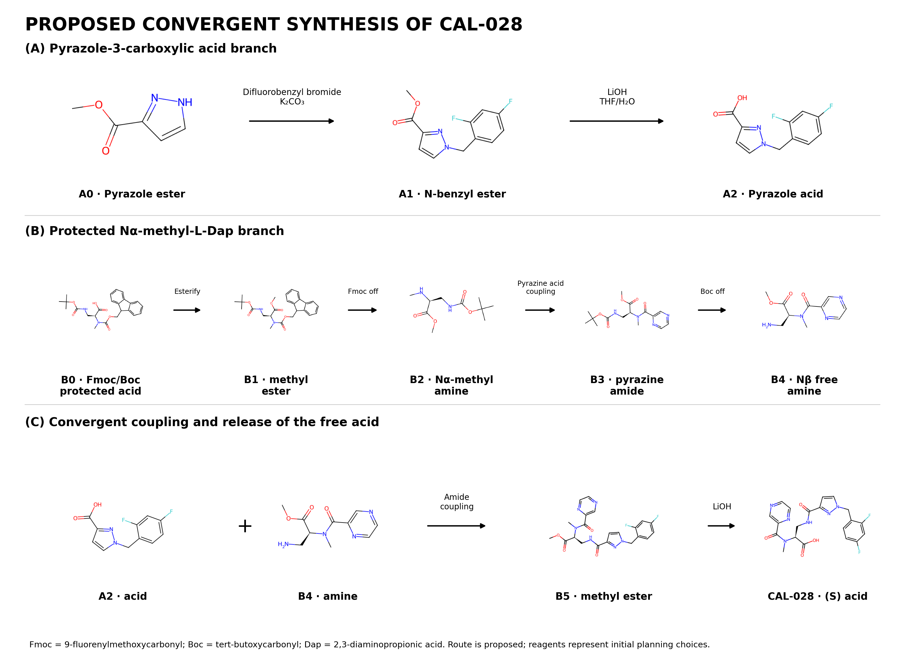

# Proposed convergent synthesis of CAL-028

**Scheme 1** illustrates the molecular structures of the proposed starting materials, intermediates, coupling partners and stereodefined CAL-028 product. The route is organized around two separately prepared fragments followed by a final amide coupling and ester hydrolysis.

[Open the full-resolution structural scheme](CAL028_proposed_convergent_synthesis.png)

## Route overview

**Branch A (A0–A2).** Pyrazole ester N-benzylation with the 2,4-difluorobenzyl substituent, followed by conversion of the methyl ester into the coupling-ready carboxylic acid.

**Branch B (B0–B4).** The protected stereodefined Nα-methyl-L-diaminopropionic acid provides the central building block. Methyl esterification, Fmoc deprotection, Nα-acylation with pyrazine-2-carboxylic acid, and Nβ-Boc deprotection yield the side-chain amino coupling partner.

**Convergent assembly (B5–B6).** Coupling A2 with B4 yields the protected CAL-028 methyl ester. Controlled hydrolysis releases the terminal carboxylic acid while retaining the designated stereochemistry.

The methyl substituent on Nα is already present in the protected amino-acid starting material. Reaction labels indicate proposed operations and initial reagent selections, not experimentally optimized conditions.

## Reproducible chemical identities

The scheme shows **chemical structures**, rather than name-only boxes or SMILES strings. Machine-readable stereodefined structures and precursor identities remain available separately in [intermediates.csv](CAL028_intermediates.csv) and the planned transformations in [route_steps.csv](CAL028_route_steps.csv). The figure can be regenerated with [draw_CAL028_scheme.py](draw_CAL028_scheme.py) using RDKit.

The associated [ASKCOS source export](ASKCOS_CAL028_treeResults.json) and [route-count audit](ASKCOS_CAL028_tree_audit.md) document the automated retrosynthetic predictions; Scheme 1 presents a separately formulated chemically convergent route.

**Status:** Proposed synthesis; compound isolation, analytical identification and yields have not been reported.
