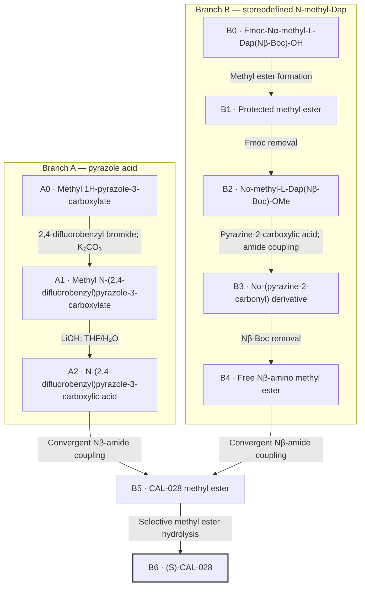

# CAL-028: proposed convergent synthetic scheme

The proposed route assembles **(S)-CAL-028** through two functionalized fragments. A protected stereodefined N-methyl-L-2,3-diaminopropionic-acid (Dap) derivative provides the amino-acid framework; a selectively N-benzylated pyrazole-3-carboxylic acid supplies the side-chain amide. The final operation unmasks the carboxylic acid.

## Scheme 1. Convergent preparation of CAL-028

This scheme is based on the molecular structure of CAL-028 and the source route records. The Nα-methyl group is present in the protected starting material, avoiding an unreliable late-stage N-methylation of an assembled multifunctional amide.

## Intermediate identities

| ID | Intermediate | Isomeric SMILES |
| --- | --- | --- |
| A0 | Methyl 1H-pyrazole-3-carboxylate | `COC(=O)c1cc[nH]n1` |
| A1 | N-(2,4-Difluorobenzyl) pyrazole methyl ester | `COC(=O)c1ccn(Cc2ccc(F)cc2F)n1` |
| A2 | N-(2,4-Difluorobenzyl) pyrazole-3-carboxylic acid | `O=C(O)c1ccn(Cc2ccc(F)cc2F)n1` |
| B0 | Fmoc-Nα-methyl-L-Dap(Nβ-Boc)-OH | `CN(C(=O)OCC1c2ccccc2-c2ccccc21)[C@@H](CNC(=O)OC(C)(C)C)C(=O)O` |
| B1 | Protected amino-acid methyl ester | `COC(=O)[C@H](CNC(=O)OC(C)(C)C)N(C)C(=O)OCC1c2ccccc2-c2ccccc21` |
| B2 | Nα-methyl-L-Dap(Nβ-Boc)-OMe | `CN[C@@H](CNC(=O)OC(C)(C)C)C(=O)OC` |
| B3 | Nα-(Pyrazine-2-carbonyl)-protected derivative | `COC(=O)[C@H](CNC(=O)OC(C)(C)C)N(C)C(=O)c1cnccn1` |
| B4 | Nβ-free amine | `COC(=O)[C@H](CN)N(C)C(=O)c1cnccn1` |
| B5 | CAL-028 methyl ester | `COC(=O)[C@H](CNC(=O)c1ccn(Cc2ccc(F)cc2F)n1)N(C)C(=O)c1cnccn1` |
| B6 | (S)-CAL-028 | `CN(C(=O)c1cnccn1)[C@@H](CNC(=O)c1ccn(Cc2ccc(F)cc2F)n1)C(=O)O` |

## Proposed transformation and selectivity plan

| Step | Transformation | Initial reagents/conditions to evaluate | Analytical focus |
| --- | --- | --- | --- |
| A1 | Pyrazole N-benzylation | 2,4-Difluorobenzyl bromide, K₂CO₃; MeCN/DMF | N-regioisomer assignment (HMBC/NOESY) |
| A2 | Methyl ester hydrolysis | LiOH; THF/H₂O | Correct carboxylic acid |
| B1 | Dap methyl ester formation | Mild esterification of protected amino acid | Retention of α-stereochemistry |
| B2 | Fmoc deprotection | Piperidine/DMF | Free Nα-methyl amine; Nβ-Boc retained |
| B3 | Nα-acylation | Pyrazine-2-carboxylic acid; HATU/DIPEA or COMU-based coupling | Hindered tertiary-amide formation |
| B4 | Nβ-Boc deprotection | TFA/DCM | Primary amine unmasked; methyl ester retained |
| B5 | Convergent amide coupling | A2 + B4; coupling reagent/base | Correct side-chain amide and regioisomer |
| B6 | Ester-to-acid conversion | LiOH, aqueous cosolvent | CAL-028 identity and enantiopurity |

Proposed starting material **Fmoc-Nα-methyl-L-Dap(Nβ-Boc)-OH** has been listed as CAS **2973753-87-4** in the route-planning records; procurement identity and stereochemistry should be matched to the vendor certificate. Pyrazole N-regioselectivity and preservation of the L-Dap α-stereocenter are key route-control points.

The scheme is a **proposed retrosynthetic/synthetic plan**, not an experimental synthesis report. Conditions are practical screens rather than optimized procedures for CAL-028.

## Source files and reproduction

- The intermediates and route conditions originate from the project's CAL-028 route bundle.
- Recreate a structure-bearing figure using [`draw_CAL028_scheme.py`](draw_CAL028_scheme.py), which uses RDKit and Matplotlib to plot the chemically defined intermediates.
- The generated target is the CAL-028 entry in `results/final_candidates.csv`.

Related descriptions of the proposed route and its mechanistic rationale may be used in the research article, which is maintained separately from the repository.
